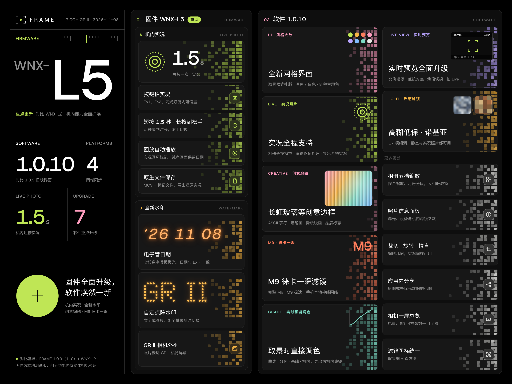

# FRAME · WNX-L5

[WNX-L5 · 当前版本](https://github.com/Lyle-xub/FRAME-GR2/blob/main/docs/versions/WNX-L5.md) · [WNX-L3 · 历史版本](https://github.com/Lyle-xub/FRAME-GR2/blob/main/docs/versions/WNX.md) · [WN3 · 历史版本](https://github.com/Lyle-xub/FRAME-GR2/blob/main/docs/versions/WN3.md)

**WNX-L5 固件 · FRAME 1.0.10（151）。** iOS 151已提交外部TestFlight审核，通过后将在原公测链接提供。

## 下载

| 平台 | 下载 | 要求 |
| :-- | :-- | :-- |
| GR II固件 | [FRAME-GR2-WNX-L5-Firmware.zip](https://github.com/Lyle-xub/FRAME-GR2/releases/download/v1.0.10/FRAME-GR2-WNX-L5-Firmware.zip) | RICOH GR II |
| Android通用版 | [FRAME-Android-1.0.10-151.apk](https://github.com/Lyle-xub/FRAME-GR2/releases/download/v1.0.10/FRAME-Android-1.0.10-151.apk) | Android 8.0及以上 |
| Android ARM64 | [FRAME-Android-arm64-1.0.10-151.apk](https://github.com/Lyle-xub/FRAME-GR2/releases/download/v1.0.10/FRAME-Android-arm64-1.0.10-151.apk) | 可选较小安装包 |
| Mac · Apple Silicon | [FRAME-macOS-1.0.10-151-arm64.dmg](https://github.com/Lyle-xub/FRAME-GR2/releases/download/v1.0.10/FRAME-macOS-1.0.10-151-arm64.dmg) | macOS 13及以上 |
| Mac · Intel | [FRAME-macOS-1.0.10-151-x64.dmg](https://github.com/Lyle-xub/FRAME-GR2/releases/download/v1.0.10/FRAME-macOS-1.0.10-151-x64.dmg) | macOS 13及以上 |
| Windows安装版 | [FRAME-Windows-1.0.10-151-Setup.exe](https://github.com/Lyle-xub/FRAME-GR2/releases/download/v1.0.10/FRAME-Windows-1.0.10-151-Setup.exe) | Windows 10/11 x64 |
| Windows便携版 | [FRAME-Windows-x64-1.0.10-151.zip](https://github.com/Lyle-xub/FRAME-GR2/releases/download/v1.0.10/FRAME-Windows-x64-1.0.10-151.zip) | 完整解压后运行 |
| iPhone / iPad | [TestFlight公测](https://testflight.apple.com/join/UHu8JxZn) · 151已提交Apple审核 | iOS / iPadOS 16及以上 |

[GitHub发行版](https://github.com/Lyle-xub/FRAME-GR2/releases/tag/v1.0.10) · [GitCode国内下载](https://gitcode.com/gcw_5N7kwGjx/FRAME-GR2/releases/v1.0.10) · [SHA-256校验](https://github.com/Lyle-xub/FRAME-GR2/releases/download/v1.0.10/SHA256SUMS.txt)

## WNX-L5：相对 WNX-L3 新增功能

- **Live Photo 拍摄与回放**：支持机身按键短按或长按拍摄照片与配套短片，回放中显示 Live 标记；新版 App 可独立发起拍摄，无需重新绑定按键。
- **电子管日期水印**：新增电子管风格的拍摄日期／时间，并优化样式选择和确认。
- **水印左右位置**：原有三槽自定水印增加各槽独立的左右位置调节。
- **GR II 相机外框**：更新相机背部外框素材及屏幕区域布局。
- **自定滤镜读回与调参**：新版 App 可读取当前自定滤镜的实际基础颜色及菜单参数，按 IMAGE 分组保存、读回参数，并确认机身滤镜切换结果。
- **实时取景状态**：向新版 App 提供画幅、自定义比例、裁切及 Shift 左右区域等读数，兼容原有状态读取方式。

## FRAME 1.0.10（151）：软件功能更新

- **实时预览**：自定义比例按实际画幅显示遮罩；支持各拍摄比例下点击对焦与对焦框、裁切焦距切换，以及更清晰的白平衡、测光、连拍和尺寸读数。
- **取景时切换与调节滤镜**：支持滤镜切换、自定滤镜参数预览和确认写入；机身更换滤镜或调整参数后同步显示。可直接在 App 中拍摄照片和 Live。
- **照片与 Live 编辑**：滤镜、调色、裁切、旋转和边框可用于本地照片与 Live Photo，封面和动态一起保留效果；新增更多边框和自有水印编辑方式。
- **高糊低保、诺基亚**：新增两款质感滤镜，按色彩、清晰、光晕、紫边和颗粒分组调节；色彩组仅调整强度。JPEG 效果默认关闭，开启时提示仅保存后生效；诺基亚默认模糊 2.0‰、颗粒大小 1.2‰。
- **滤镜库与编辑页**：统一新建滤镜的默认图标，优化名称、图标来源和参考图的编辑布局。
- **界面与连接体验**：改善白色模式可读性；连接后先识别完整功能，再开放入口；未适配的固件功能明确显示为不可用。
- **相册、传输与保存**：改善照片浏览、Live 播放与导出、拟合和大图保存的稳定性，完善进度、取消及失败反馈；保存保留原尺寸。

## 安装与更新

GR II固件包内文件名为 `rg2_v003.frm`；首次安装FRAME前请确认相机已更新至理光官方3.00，并按包内使用说明操作。Mac按设备架构选择安装包；Windows可使用安装版或完整解压便携版。iOS通过TestFlight分发。

## 支持开发

如果 FRAME 让你的 GR II 多了一点想拍的理由，欢迎请我喝杯咖啡，支持后续开发与维护。

赞赏完全自愿。点一个 Star、分享你的作品或反馈使用体验，也同样是很好的支持。

  
  

使用对应 App 扫码；也可点击图片保存后识别。感谢每一份支持。

## 历史版本

- [WNX-L3与配套110](https://github.com/Lyle-xub/FRAME-GR2/blob/main/docs/versions/WNX.md)
- [WN3历史版本](https://github.com/Lyle-xub/FRAME-GR2/blob/main/docs/versions/WN3.md)

FRAME为独立扩展项目，不代表理光官方发布。胶片与相机商标归各自权利人所有。
